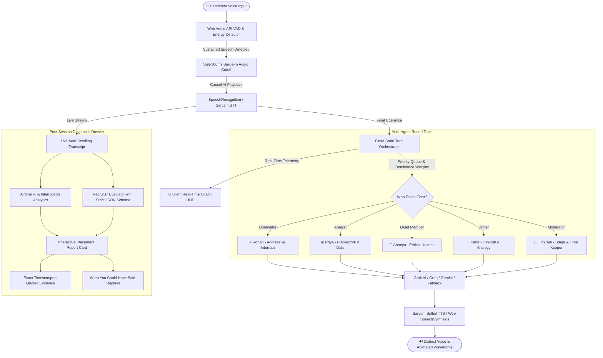

# 🎙️ easy.gd — Voice-First AI Group Discussion Placement Simulator

<p align="center">
  
  
  
  
  
  
  
</p>

> **"Group Discussion (GD) is the toughest elimination round in campus placements, yet almost no student can practice it properly. You need 6 to 8 people, an unbiased moderator, and a structured topic. Even then, peers almost never give candid, actionable feedback."**
> 
> **`easy.gd`** is a voice-first web application where students sit at a virtual round-table discussion room with realistic AI candidates who debate each other, challenge arguments, and test floor-reclaiming skills—ending with a corporate recruiter diagnostic report where **every single critique links to an exact quote from the transcript**.

---

## 📑 Table of Contents
- [The Problem: The 80% Elimination Trap](#-the-problem-the-80-elimination-trap)
- [System Architecture & Data Flow](#-system-architecture--data-flow)
- [Core Differentiators ("Make It Yours")](#-core-differentiators-make-it-yours)
- [The 6 AI Persona Archetypes](#-the-6-ai-persona-archetypes)
- [How Turn-Taking & Sub-300ms Barge-In Works](#-how-turn-taking--sub-300ms-barge-in-works)
- [Recruiter Feedback & Evidence Engine](#-recruiter-feedback--evidence-engine)
- [Hackathon Rules & Privacy Guarantee](#-hackathon-rules--privacy-guarantee)
- [Tech Stack & Multi-Provider Architecture](#-tech-stack--multi-provider-architecture)
- [Quick Reference: Free-Tier API Providers](#-quick-reference-free-tier-api-providers)
- [Local Setup & Running](#-local-setup--running)
- [Project Structure](#-project-structure)

---

## 🚨 The Problem: The 80% Elimination Trap

In campus recruitment across top tech giants (TCS, Infosys, Amazon, Microsoft) and management consultancies (Deloitte, McKinsey, BCG), **70% to 80% of candidates are disqualified in the 15-minute Group Discussion**.

Candidates do not get eliminated because they lack aptitude. They get eliminated because:
1. **The Frozen Introvert**: Paralyzed by aggressive peers, waiting for an invitation that never arrives.
2. **The Runaway Dominator**: Monopolizing airtime, cutting others off, and being flagged as toxic by corporate evaluators.
3. **The Isolated Ping-Ponger**: Treating the GD like an individual interview—speaking only to the moderator rather than building on peer viewpoints.
4. **The Late Summary Blunder**: Re-stating personal dogmas during the final summary instead of synthesizing group consensus.

---

## 🏛️ System Architecture & Data Flow



---

## ✨ Core Differentiators ("Make It Yours")

| Feature | How It Works in `easy.gd` | Why Recruiters Care |
|---|---|---|
| **Sub-300ms Barge-In** | Web Audio API detects user speech amplitude; instantly terminates AI audio (`speechSynthesis.cancel()`). | Tests floor reclamation without chaotic audio overlap. |
| **Inter-Agent Banter** | AI candidates address each other by name, challenge each other, and cite previous comments. | Recreates the real multi-party dynamic of a campus GD room. |
| **Silent Real-Time HUD Coach** | Unobtrusive floating cards nudging the candidate: *"⏱️ 90s without speaking"*, *"⚡ Challenge Rohan's claim"*. | Trains situational awareness during live pressure. |
| **"What You Could Have Said" Replay** | Post-GD analysis pinpoints exact timestamps where candidate missed an opening and provides an elite alternative script. | Teaches candidate the "Bridge Technique" and "Anchor Pivot". |
| **Hinglish & Regional Flavor** | Native support for Hinglish campus cadence (*"Point to valid hai, but look at the unit economics..."*). | Reflects the reality of Indian campus recruitment rooms. |
| **Multiple GD Formats** | Placement Classic, Case-Study, Abstract, Controversial, and **Fishbowl Mode** (observe round 1 before tagging in). | Prepares candidate for consultancies, B-schools, and IT giants. |
| **Zero-Setup Resilience** | Works right out of the box with browser Web Speech and smart simulated dialogue if no API key is provided. | Never freezes, crashes, or blocks practice during demo or evaluation. |

---

## 👥 The 6 AI Persona Archetypes

Each AI participant has their own prompt directives, vocal timbre, pitch, and placement personality:

| Avatar | Persona | Archetype | Voice & Pitch | Conversational Behavior |
|:---:|---|---|---|---|
| 👨‍💼 | **Vikram Iyer** | Corporate Placement Director (Moderator) | Deep, formal Indian English (`arvind`, 0.95x rate) | Opens the round, states rules, warns quiet members, curbs dominators, calls for 30s summary. |
| ⚡ | **Rohan Sharma** | The Aggressive Dominator | Fast, high-energy (`amol`, 1.15x rate) | Jumps in first, speaks with high conviction, defends unverified claims, cuts others off. |
| 📊 | **Priya Nair** | The Data-Driven Analyst | Structured, calm (`pavithra`, 1.0x rate) | Cites business frameworks (PESTEL, ROI, unit economics), demands empirical evidence. |
| 🌱 | **Ananya Sen** | The Thoughtful Introvert | Gentle, measured (`meera`, 0.88x rate) | Yields when interrupted, speaks rarely but provides deep human-centric ethical nuances. |
| 🎨 | **Kabir Mehta** | The Lateral Diverger | Expressive Hinglish (`amartya`, 1.05x rate) | Brings IPL cricket and Bollywood analogies, drifts off-topic, testing candidate steering skills. |
| 🤝 | **Aarav Patel** | The Consensus Builder | Warm, diplomatic (`arvind`, 0.98x rate) | Reconciles conflicting arguments, seeks common ground between Rohan and Priya. |

---

## ⚡ How Turn-Taking & Sub-300ms Barge-In Works

Unlike chatbots that follow a strict ping-pong sequence ($User \to AI \to User$), `easy.gd` operates on an **event-driven state machine**:
1. **Silence Detection (VAD)**: The Web Audio API calculates root-mean-square (RMS) energy. When the user finishes speaking, a configurable patience window (800ms – 2000ms) runs.
2. **Priority Selection**: If the user remains silent, the orchestrator evaluates:
   - Who spoke last? (Avoid same persona speaking consecutively)
   - Dominance probability (Dominator: 85%, Analyst: 60%, Quiet: 25%)
   - Moderator intervention (if quiet for >60s)
3. **Instant Barge-In**: If the candidate speaks while an AI is talking:
   - Backchannels ("uh-huh", "hmm", "ok") are filtered out.
   - If sustained speech (>250ms) is detected, `audioEngine.stopSpeaking()` is called immediately.
   - The AI's utterance in the transcript is marked: `[Interrupted by Candidate]`.
   - Priority transfers immediately to the candidate.

---

## 📊 Recruiter Feedback & Evidence Engine

At the conclusion of the session, the engine computes quantitative statistics and evaluates 6 non-negotiable placement competencies:

```
┌─────────────────────────────────────────────────────────────┐
│              RECRUITER PLACEMENT DOSSIER                    │
├─────────────────────────────────────────────────────────────┤
│ Overall Score: 84/100         Verdict: Strong Hire (Top 10%)│
│ Speaking Airtime: 26%         Placement Sweet Spot: 20–30%   │
├─────────────────────────────────────────────────────────────┤
│ 1. Initiative & Scope Definition ................... 8.5/10 │
│ 2. Idea Quality & Structured Thinking .............. 8.0/10 │
│ 3. Active Listening & Synthesizing ................. 8.5/10 │
│ 4. Floor Control & Airtime Sweet Spot .............. 8.5/10 │
│ 5. Composure & Interruption Management ............. 8.0/10 │
│ 6. Closing & Consensus Formulation ................. 8.0/10 │
└─────────────────────────────────────────────────────────────┘
```

### Direct Transcript Evidence Linkage
Every score links to an exact quote and timestamp:
> **Initiative & Scope Definition (8.5/10)**:  
> *Quoted Moment at +0:42s:* `"I believe before jumping to conclusions, we must divide this topic into two angles: developer productivity vs entry-level displacement."`  
> *Recruiter Take:* Candidate demonstrated leadership by establishing a structured framework early without dogmatism.

### "What You Could Have Said" Replay
Pinpoints moments where the student was passive or gave a weak response:
- **Trigger at +1:15s**: Rohan asserted that speed-to-market always trumps risk compliance.
- **What Happened**: Candidate remained silent.
- **Suggested High-Impact Script**: *"I agree with Rohan that speed provides market momentum, but Priya's point on regulatory risk cannot be ignored. A two-speed strategy lets us capture early adopters while stress-testing compliance."*
- **Strategic Principle**: The Bridge Technique (reconcile opposing views to emerge as natural leader).

---

## 🛡️ Hackathon Rules & Privacy Guarantee

- **Transparent AI Labeling**: Every non-user avatar card explicitly displays an `[AI]` badge and `(AI Participant)` role. The GD room features a persistent top disclaimer banner.
- **Zero Audio Retention**: Audio is captured and processed **strictly in-memory in real time**. **No audio files, recordings, or voice buffers are saved to disk, server, or cloud storage.**

---

## 🛠️ Tech Stack & Multi-Provider Architecture

- **Frontend**: React 18, Vite, TypeScript, Tailwind CSS, Lucide Icons, Canvas Web Audio API
- **Backend**: Node.js, Express (`/api/chat/turn`, `/api/sarvam/tts`, `/api/sarvam/stt`, `/api/report/evaluate`)
- **LLM Reasoning**:
  - **Grok AI (`grok-2` / `grok-beta`)**: Native xAI API integration for witty, sharp inter-agent dynamics.
  - **Groq (Llama 3.3 70B)**: Ultra-fast free-tier multi-turn responses.
  - **Google Gemini (Gemini Flash)**: Analytical placement report evaluations.
  - **Local Smart Simulation**: Zero-downtime offline rule-based dialogue engine (runs with no API keys).
- **Voice Stack**:
  - **Sarvam AI (Saarika STT & Bulbul TTS)**: Indian English & Hindi voices (`arvind`, `meera`, `pavithra`, `amol`, `amartya`).
  - **Browser Web Speech Engine**: 100% free, zero-config STT and multi-voice synthesis fallback.

---

## 🔗 Quick Reference: Free-Tier API Providers

All providers can be configured directly in the web app's **API Config** modal:

| Provider | Purpose | Free Tier | Direct Signup Link |
|---|---|---|---|
| **Sarvam AI** | Indian English & Hinglish STT/TTS | Free credits on signup | [sarvam.ai](https://www.sarvam.ai) |
| **Groq** | Ultra-fast LLM multi-agent reasoning | **14,400 req/day FREE** | [console.groq.com](https://console.groq.com) |
| **Google Gemini** | LLM dialogue & report generation | **1,500 req/day FREE** | [aistudio.google.com](https://aistudio.google.com) |
| **Grok AI (xAI)** | Custom placement dialogue | API Portal | [x.ai](https://x.ai) |
| **Browser Web Speech** | STT & multi-voice synthesis | **100% Free / No Key** | Built into Chrome & Edge |

---

## 🚀 Local Setup & Running

### Prerequisites
- Node.js v18+ and npm installed

### 1. Clone the Repository
```bash
git clone https://github.com/andyanuj1543-ctrl/easy.gd.git
cd easy.gd
```

### 2. Install Dependencies
```bash
npm install
```

### 3. Configure API Keys (Optional)
The app works out of the box without any keys using the built-in browser voice engine and local simulation. If you have API keys, copy `.env.example` to `.env` or enter them in the UI:
```bash
cp .env.example .env
```

### 4. Run the Development Servers
```bash
# Start backend server (Port 5050)
npm run start

# In a second terminal, start frontend (Port 5173)
npm run dev:client
```

Open [`http://localhost:5173`](http://localhost:5173) in your browser.

---

## 📂 Project Structure

```
easy.gd/
├── .env.example                       # Environment variables template
├── .gitignore                         # Standard git ignore
├── README.md                          # Comprehensive documentation
├── index.html                         # Entry HTML with custom fonts
├── package.json                       # Unified scripts & dependencies
├── vite.config.ts                     # Vite config with backend proxy
├── tailwind.config.js                 # Tailwind theme & animation keyframes
├── server/                            # Node.js + Express Backend
│   ├── index.ts                       # Server entrypoint (Port 5050)
│   ├── types.ts                       # Backend interfaces
│   ├── data/
│   │   ├── personas.ts                # 6 Persona profiles & behavioral instructions
│   │   └── topics.ts                  # Curated placement topics & case studies
│   ├── routes/
│   │   └── api.ts                     # REST endpoints (/turn, /sarvam, /report)
│   └── services/
│       ├── grokService.ts             # Grok / Groq / Gemini multi-agent turn generator
│       ├── sarvamService.ts           # Sarvam Bulbul TTS & Saarika STT integration
│       └── reportEvaluator.ts         # Recruiter diagnostic feedback engine
└── src/                               # React + TypeScript Frontend
    ├── App.tsx                        # Main application controller & state machine
    ├── main.tsx                       # React root render
    ├── index.css                      # Custom Tailwind styling & glow animations
    ├── types/
    │   └── gd.ts                      # Frontend TypeScript interfaces
    ├── data/
    │   ├── personas.ts                # Audio and persona presets
    │   └── topics.ts                  # Topic repository
    ├── services/
    │   ├── audioEngine.ts             # VAD, barge-in, STT, and speech synthesizer
    │   └── gdOrchestrator.ts          # State machine: turns, pauses, nudges
    └── components/
        ├── common/Navbar.tsx          # Top nav with stage indicators & settings
        ├── setup/
        │   ├── SetupModal.tsx         # Topic picker, panel size, mic tester
        │   └── ApiKeyConfigModal.tsx  # API key manager with free-tier guide
        ├── room/
        │   ├── GDRoomView.tsx         # 3D circular virtual conference table
        │   ├── AvatarCard.tsx         # Animated audio waveform participant avatar
        │   ├── LiveTranscript.tsx     # Auto-scrolling transcript with timestamps
        │   ├── SilentCoachHUD.tsx     # Real-time tactical coach HUD
        │   ├── GDControlsBar.tsx      # Mic mute, barge-in button, hand raise
        │   ├── AudioVisualizer.tsx    # Canvas microphone frequency visualizer
        │   └── PrepCountdownModal.tsx # 60-second silent prep with scratchpad
        └── report/
            └── DiagnosticReport.tsx   # Recruiter report dossier with quote links
```

---

## 📜 License
MIT License. Built for students to crack campus placement Group Discussions.